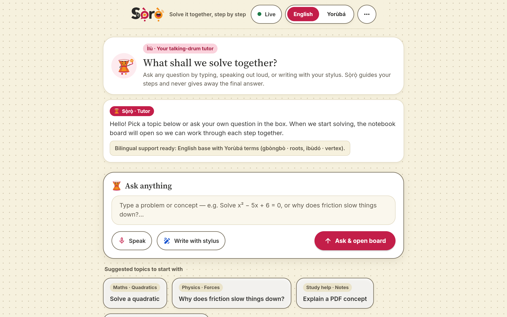
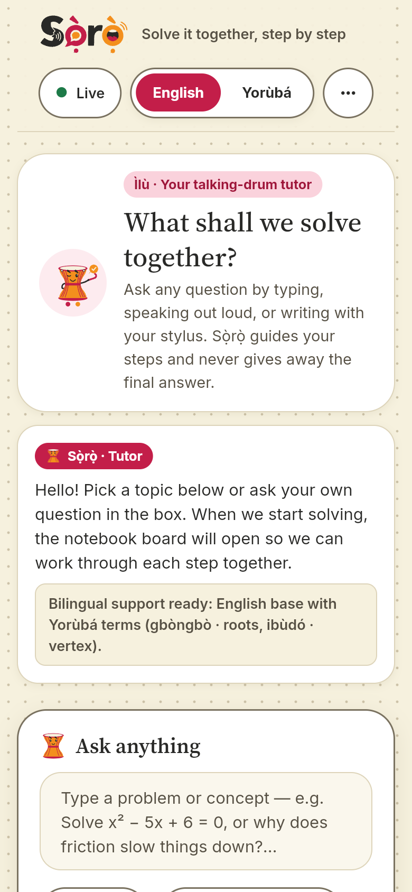
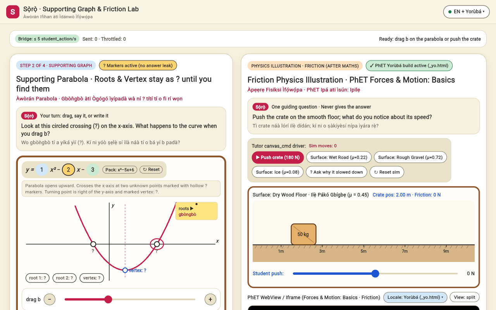
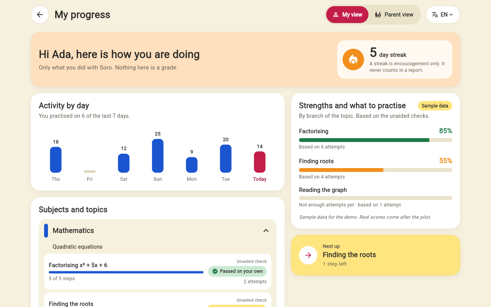
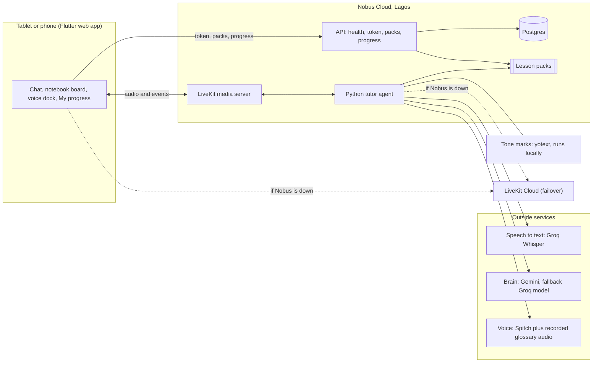
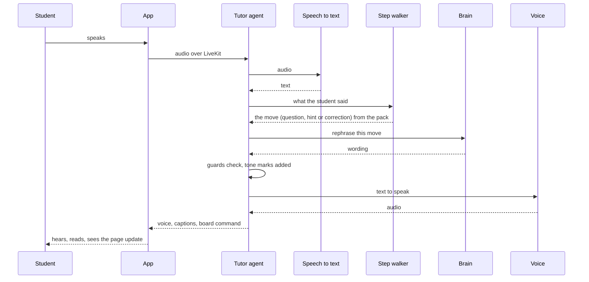

# Sọ̀rọ̀ (Soro)

**A tutor that talks a problem through with you, in your own language, and never hands you the answer.**

<!-- Banner image: the captain will supply it. Place it at docs/banner.png and add it here. -->

Soro is an English-first STEM tutor. It solves problems with students, out loud, in the language they think in. We launch with Yoruba. It asks questions. It does not give answers.

Built for the Ogun Digital Summit 2026 hackathon, EdTech track, with Nobus Cloud as infrastructure sponsor.

> **Status, 25 Nov 2026:** a working prototype, not a finished product. Some parts run today and some are drafts or plans. Every feature below is marked **Built**, **Partly built** or **Planned**, and the gaps are listed in plain words.



## What is Soro?

Imagine a patient older student sitting next to you with a notebook. You say what you are stuck on. They do not solve it for you. They ask one small question. You answer. They write your answer on the page, then ask the next small question. At the end they give you a fresh problem to try alone.

That is Soro. A student types, speaks or writes with a pen. Soro replies by voice and on a notebook page.

The name is Yoruba. **Sọ̀rọ̀** means "speak". **Ó yé mi** means "I understand it", and that is the feeling we are aiming for. The tutor's face is **Ìlù**, a small talking drum.

Soro is English-first. Yoruba is the first extra language. Language is a plug-in slot, so more can follow.

## The problem and the evidence

Many Nigerian students learn maths and science in English, a language they do not think in at home. The words for "quadratic", "root" or "friction" can be missing in the language they know best. Then the idea itself feels foreign.

What we verified:

- **Language matters in the classroom.** A 2026 study in the African Journal of Research in Mathematics, Science and Technology Education found that familiar language and culturally familiar examples help Nigerian students connect abstract maths to real life. The blockers it names are missing standard maths terms and limited resources in indigenous languages. It calls for bilingual teaching models. Source: <https://journals.co.za/doi/abs/10.1080/18117295.2026.2639266>
- **Chatbots tend to give the answer.** A student who is handed the answer copies it and learns little. Soro is built so that it cannot give the final answer, and ends each session with a problem the student does it alone.
- **The words must be right.** Our research found that tone marks and under-dots change Yoruba meaning, so every term is hand-checked. Only two terms are verified so far (see [honest gaps](#what-is-not-verified-yet)).

Our own research notes also include a ranked list of speech models and licences. We name only the facts that we checked.

## One session, step by step

1. **Home: a calm chat.** The student sees one big "ask anything" box with a few suggested topics. Statistics stay out of the way. A small streak badge sits nearby. 
2. **Ask.** Type, speak, or write with a stylus. Soro picks the lesson pack that fits, for example quadratics.
3. **The notebook board opens.** The worked calculation is written step by step on a ruled page, in proper maths notation. **Tutor ink is crimson. Student ink is blue.** The tutor writes only what the student said, or the shape of the next step with a blank, for example `(x - ▢)(x - ▢) = 0`. It never writes the next answer.
4. **One small question at a time.** A wrong answer gets a correction aimed at that exact mistake. Stuck again, and a hint ladder gives a little more help each time.
5. **Analogies.** If an idea is abstract, Soro offers one everyday picture. The roots of a quadratic are where a thrown ball meets the ground. Friction is why a danfo skids on a wet road. Then it goes back to the student's step.
6. **A supporting graph.** The parabola sits beside the working. Roots and vertex show as `?` until the student finds them. 
7. **The unaided check.** At the end Soro offers a fresh problem: "Ready to try one on your own, with no help from me?"
8. **My progress and the streak.** One tap opens a read-only page with activity by day and the result of each unaided check, plus a plain counter of consecutive learning days. A parent view shows the same page. 

## Features and status

| Feature | Status | What is true today |
|---|---|---|
| Home chat shell, "ask anything" box, theme, English and Yoruba labels | **Built** | In `app/`, runs as Flutter web on phone, tablet and laptop widths. |
| My progress page, streak badge, parent view | **Built** | Reads `GET /progress`; demo data is a seeded anonymous learner. |
| Progress API and streak | **Built** | FastAPI plus Postgres; streak uses unique session dates in `Africa/Lagos`. |
| Lesson packs | **Built** | 10 quadratics problems with step graphs, misconception corrections, hint ladders and a transfer check, plus a friction pack. `content/validate.py` checks them. |
| Step-graph tutor logic | **Built** | `agent/step_graph.py` with tests: one question per reply, leak guard, hint ladder. |
| Gemini main, Groq fallback brain and text loop | **Partly built** | In draft PR #21, not merged. Needs real keys to run. |
| Supporting graph with `?` markers, friction illustration | **Built** | In `app/`. The friction screen has a hook to embed a PhET simulation; we have not verified a Yoruba build of it. |
| Notebook board session and voice dock | **Partly built** | Open PR #29, not merged. |
| Message contracts between app and agent | **Partly built** | Open PR #28, not merged. `contracts/` is empty on main. |
| Server on Nobus (LiveKit, Postgres, API) | **Partly built** | Runs in Docker and a test client joined a room. No HTTPS, no phone join, no block volume yet. |
| Failover to LiveKit Cloud | **Partly built** | The `LIVEKIT_MODE` switch exists. No real Cloud project is configured. |
| Voice worker (voice detection, speech to text, events) | **Partly built** | Draft only, **not run yet**. |
| Spoken replies (Spitch plus recorded glossary audio) | **Planned** | Not built. |
| Yoruba speech to text | **Planned** | Not built. The model named in our notes is non-commercial, so it needs a decision. |
| Tone marks with yotext | **Planned** | Chosen and tested alone in research; not wired in. |
| Whiteboard tucks away after about 10 seconds idle | **Planned** | Decided, not built. |
| Strengths and weaknesses, weekly parent email, daily plan | **Planned** | Later. For the demo, seeded sample data only. |
| Offline lesson packs | **Planned** | Only if time allows. |

## Architecture

The short version: the **app** shows the notebook and talks to the server. A **voice room** carries sound. A **Python tutor agent** listens, decides the next move from a **step graph**, and speaks. **Lesson packs** hold the content. A small **API** serves packs and progress.



### One spoken turn



**Latency budget:** the goal is under about 3 seconds from the end of the student's speech to the start of the tutor's voice. This is a target, not a measurement. The full pipeline has not been run end to end yet.

### The key design idea

**The step graph decides what the tutor does. The brain only rephrases.** Each problem is a list of steps. Each step has acceptable answers, known mistakes with a matching correction, and a hint ladder. The walker picks the next move from that data. The language model is then asked to say that move in friendly words. It does not choose the move, and it cannot skip a step.

Rules are enforced in code, not only in the prompt:

- exactly one question per reply;
- a leak guard blocks final answers (roots, factors, vertex);
- on the notebook, the tutor writes only the student's words or a next step with blanks;
- if the brain's output breaks any rule, the app uses the verified text from the pack.

So even a generic free model cannot give the answer away. See [docs/ARCHITECTURE.md](docs/ARCHITECTURE.md) for more detail.

### How the pieces fit

- **App** ([`app/`](app/)): Flutter web. Home chat, notebook board, graph, My progress, theme and strings in English and Yoruba.
- **Agent** ([`agent/`](agent/)): the tutor. `step_graph.py` is the walker. The brain switch and voice worker are in draft PRs.
- **Content** ([`content/`](content/)): lesson packs as JSON, a validator, and `NATIVE-CHECK.md`, the list of Yoruba strings waiting for a native speaker.
- **Infra** ([`infra/`](infra/)): Docker compose for LiveKit, Postgres and the FastAPI service, plus migrations.
- **Contracts** ([`contracts/`](contracts/)): the agreed message formats between app and agent. Freeze is in open PR #28.

## Data and privacy

- **Stored:** progress records in Postgres on the Nobus instance in Lagos. The demo uses one seeded anonymous learner. No real names are stored.
- **Seen by outside services:** speech goes to the speech-to-text service. Text goes to the brain and the voice service. We never send names.
- **Law:** we design for the Nigeria Data Protection Act 2023. Sharing a student's record with a parent or school needs consent, with a clear switch and no surprise emails.
- **Honest limits:** free-tier Gemini prompts may be used by Google for training. So use **demo data only**. No real student data should go through this prototype.

## Run it yourself

You need Python 3.11 or 3.12 with [uv](https://docs.astral.sh/uv/), Flutter (Dart SDK 3.13 or newer), and Docker.

```bash
# lesson packs
python3 content/validate.py
# tutor logic tests
cd agent && uv run pytest
# API tests
cd infra/api && uv run pytest
# Flutter web app
cd app && flutter pub get && flutter run -d chrome
# server stack (LiveKit, Postgres, API)
cd infra && cp .env.example .env   # then fill it in
docker compose up --build
curl http://localhost:8000/health
curl http://localhost:8000/progress
```

Text tutor loop (needs the brain from PR #21 and keys in `agent/.env`): `cd agent && uv run python console.py`.

**Environment variables**, by name only. Copy [`.env.example`](.env.example) and [`infra/.env.example`](infra/.env.example). Keys live only in `.env` files, which are gitignored.

- Speech to text: `GROQ_API_KEY`, `SORO_STT_MODEL`, `SORO_STT_LANGUAGE`
- Brain: `GEMINI_API_KEY`, `SORO_BRAIN_PROVIDER`, `SORO_BRAIN_MODEL`, `SORO_BRAIN_FALLBACK_PROVIDER`, `SORO_BRAIN_FALLBACK_MODEL`
- Voice: `SPITCH_API_KEY`, `SORO_TTS_MODE`, `SORO_AUDIO_CACHE_DIR`
- Media server: `LIVEKIT_MODE` (`nobus` or `cloud`), `NOBUS_LIVEKIT_URL`, `NOBUS_LIVEKIT_API_KEY`, `NOBUS_LIVEKIT_API_SECRET`, `CLOUD_LIVEKIT_URL`, `CLOUD_LIVEKIT_API_KEY`, `CLOUD_LIVEKIT_API_SECRET`
- Server: `DATABASE_URL`, `POSTGRES_PASSWORD`, `SORO_CORS_ORIGINS`, `SORO_API_HOST`, `SORO_API_PORT`

Working model names on our accounts: `SORO_BRAIN_MODEL=gemini-3.5-flash`, `SORO_BRAIN_FALLBACK_MODEL=openai/gpt-oss-20b`.

### What is not verified yet

- HTTPS (needs a domain), a phone join, Postgres on a block volume.
- Failover through LiveKit Cloud: the switch exists, but no real Cloud project is configured.
- The voice worker has not been run.
- Only `gbòǹgbò` and `ògógó ìyípadà` are verified Yoruba. Every other Yoruba string is a draft, see `content/NATIVE-CHECK.md`.
- The sub-3-second latency target has not been measured end to end.
- When writing this README we did not start Docker or Flutter ourselves; commands above come from the repo's files and earlier merged work.

## Repo layout, team and roadmap

```text
app/         Flutter web app
agent/       tutor logic (step graph, brain, voice worker)
content/     lesson packs, validator, native-speaker checklist
infra/       Docker compose, API, migrations, scripts
contracts/   message formats between app and agent
docs/        architecture notes and screenshots
```

**How we work:** work is tracked as GitHub issues, one per task. Each task becomes a pull request into `main`, and each worker writes a short report on the issue. The pinned handoff issue (#16) records the locked decisions.

**Team**

- Ezechukwu Miracle, cross-platform engineer (app and notebook canvas)
- Olowolayemo Goodness Olusore, back-end and AI engineer (tutor, content, server)

**Roadmap:** voice loop end to end, spoken Yoruba replies, native-speaker review of all Yoruba text, Yoruba speech to text, failover test, then learning plan and school reports.

## Licences and dependencies

No licence file has been added yet. Pick one before reuse. Notes:

- Some speech models we looked at are **non-commercial** (for example the multilingual Nigerian speech models). They are demo-only and not part of a product without a licence deal.
- yotext (tone marks) is MIT. Flutter, LiveKit, FastAPI and Postgres are open source. Gemini, Groq and Spitch are hosted services with their own terms.
- Fonts: Inter and Source Serif 4 are bundled in `app/assets/fonts/`.

**Acknowledgements:** Nobus Cloud for infrastructure and the Ogun Digital Summit team. PhET simulations are **not** used or bundled by Soro.

## Hackathon context

Ogun Digital Summit 2026 hackathon, 25 Nov 2026, EdTech track, with Nobus Cloud as the cloud partner. The judges look for a clear problem with evidence, a local fit, a working prototype, believable impact, and a team that can explain its limits. This README tries to do the last one honestly.
