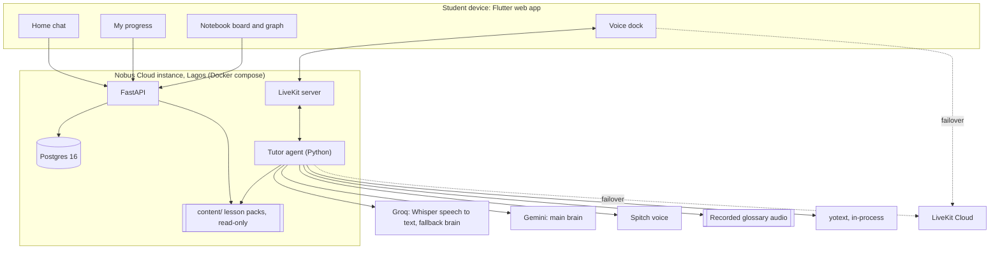
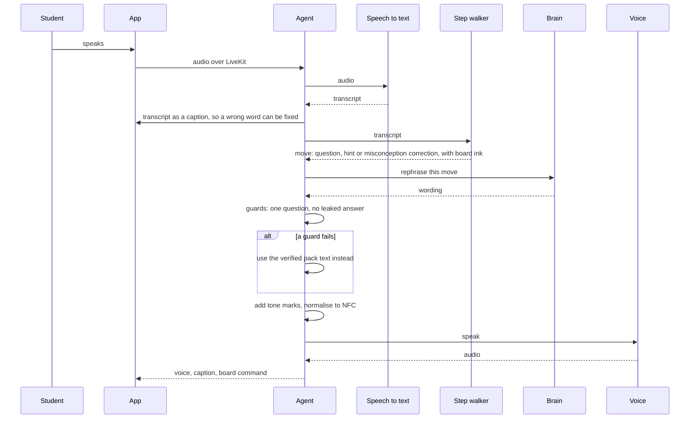

# Soro architecture

This page goes deeper than the [README](../README.md). Status words match the README: **Built**, **Partly built**, **Planned**.

## 1. Who talks to whom



What is real today: the app screens (home, progress, graph and friction), the API with `/health`, `/packs/{id}`, `/session/token`, `/progress`, Postgres, the lesson packs, and the step walker. The voice dock and board session are in open PR #29. The agent's voice worker and brain switch are drafts. Spitch voice, yotext wiring and the real Cloud failover are not done.

## 2. The API

| Route | Purpose |
|---|---|
| `GET /health` | Is the server up. |
| `POST /session/token` | Issues a LiveKit token. `LIVEKIT_MODE=nobus` or `cloud` picks which server the token is for. |
| `GET /packs/{topic_id}` | Returns a lesson pack from `content/`. |
| `GET /packs/{topic_id}/audio/{filename}` | Serves recorded glossary audio. |
| `GET /progress` | Activity by day, unaided check results and the streak. |

Migrations in `infra/api/migrations/` run on startup when `DATABASE_URL` is set. The streak counts unique session dates in `Africa/Lagos`.

## 3. One spoken turn in detail



### Latency budget (target, not measured)

| Stage | Aim |
|---|---|
| Speech to text | about 0.7 s |
| Step walker | a few ms (plain code) |
| Brain, first words | about 0.8 s |
| Guards and tone marks | well under 0.1 s (yotext restore took about 0.1 ms per sentence in our research) |
| Voice, first audio | about 0.8 s |
| Network | the rest |
| **Total** | **under about 3 s** |

Spitch is expected to limit concurrent calls on one account, so glossary audio is pre-rendered ahead of time and used as the live fallback.

## 4. The step graph

Every lesson pack follows the same shape:

```text
pack -> problems[] -> steps[]
step -> prompt, acceptable answers, misconception map (wrong answer -> targeted correction),
        hint ladder, board ink
pack -> glossary (English and Yoruba terms), transfer_check (one fresh problem, no help)
```

Why this design: the tutor is consistent, a teacher can read and audit it, and a small free model is enough, because the model never decides the move.

## 5. Failover

Both the app token and the agent connection are chosen by `LIVEKIT_MODE`. If the Nobus server is down, switching to `cloud` points both at LiveKit Cloud. **The switch exists; no real Cloud project is configured, so it has not been tested for real.**

## 6. Where each part lives

| Part | Folder |
|---|---|
| App | [`app/`](../app/) |
| Tutor logic | [`agent/`](../agent/) |
| Lesson packs and validator | [`content/`](../content/) |
| Server stack | [`infra/`](../infra/) |
| Message formats | [`contracts/`](../contracts/) (freeze in open PR #28) |
| Screenshots | [`docs/screenshots/`](screenshots/) |
